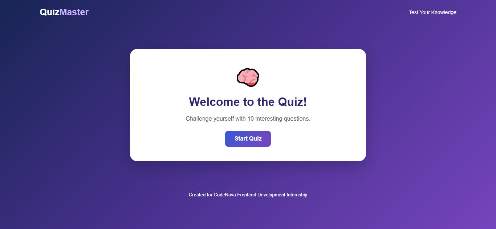

Interactive Quiz Website

About the Project

This is an interactive quiz website developed as part of my CodeNova Frontend Development Internship.

It allows users to answer multiple-choice questions and check their scores.

Features

- Multiple-choice questions.
- Interactive answer selection.
- Instant feedback.
- Progress tracking.
- Final score display.
- Restart quiz option.

Technologies Used

- HTML
- CSS
- JavaScript
- JSON
## Website Screenshot

Live Demo

"View Quiz Website" (https://harshadabhayade-hue.github.io/CodeNova-Task2-Quiz/task2.html)

GitHub Repository

"View Source Code" (https://github.com/harshadabhayade-hue/CodeNova-Task2-Quiz)

Internship

CodeNova Frontend Development Internship – Task 2
